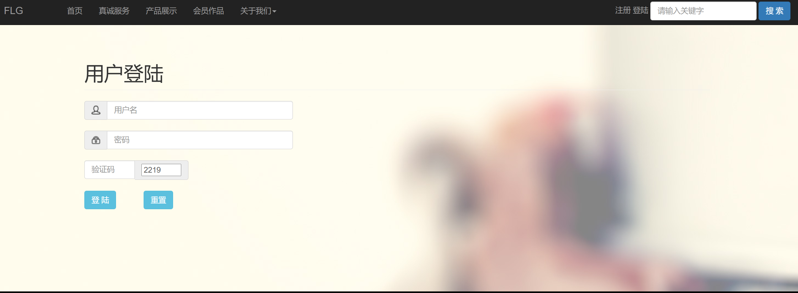

# FLG Website

A static, multi-page website for **FLG Photography Studio** (FLG摄影工作室), a studio offering portrait, wedding, family and outdoor/landscape photography. The site presents the studio, its services and its portfolio, with seasonal photo galleries and a member login page.

Built with **HTML5**, **CSS3**, **Bootstrap 3** and **jQuery**. There is no build step or server-side code.

<p align="center">
  
</p>

## Pages

| File | Page |
| --- | --- |
| `index.html` | Home (首页): banner slider, studio intro, featured work |
| `jianjie.html` | About the studio (公司简介) |
| `dongtai.html` | Studio news (公司动态) |
| `chanpin.html` | Products / portfolio (产品展示), linking to the four seasonal galleries |
| `fuwu.html` | Services (我们服务): portraits, landscapes, weddings, cards |
| `huiyuan.html` | Member works (会员作品) |
| `denglu.html` | Member login (用户登录) |
| `sanji1.html` – `sanji4.html` | Gallery detail pages for spring, summer, autumn and winter |

The page file names are pinyin of the Chinese page titles (for example `chanpin` = 产品, "products"; `sanji` = 三级, "third-level page").

## Project structure

```
.
├── index.html, jianjie.html, ...   # Site pages (see table above)
├── css/                            # Bootstrap and grid styles
├── js/                             # jQuery, Bootstrap and gallery plugins
├── images/                         # Photos used by the pages
│   ├── spring*.jpg, summer*.jpg,
│   │   autumn*.jpg, winter*.jpg    # Seasonal gallery photos
│   └── portrait.jpg, wedding-*.jpg, *-card.jpg, ...
├── img/                            # Banners, icons and layout images
├── subpages/                       # Earlier standalone version of the gallery pages,
│                                   # with its own css/, js/ and images/
├── index.png, works.png, login.png # Screenshots
└── README.md
```

## Running locally

Open `index.html` directly in a browser, or serve the folder with any static file server, for example:

```bash
python3 -m http.server 8000
# then visit http://localhost:8000
```

## Screenshots

| Member works | Login |
| --- | --- |
|  |  |
